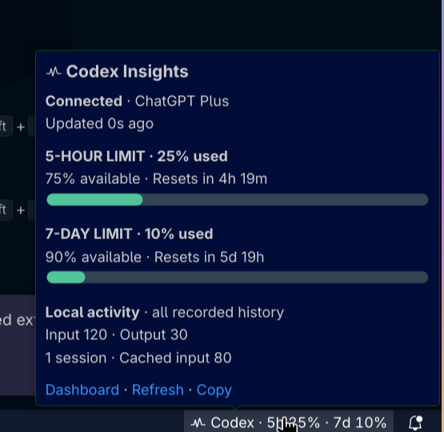
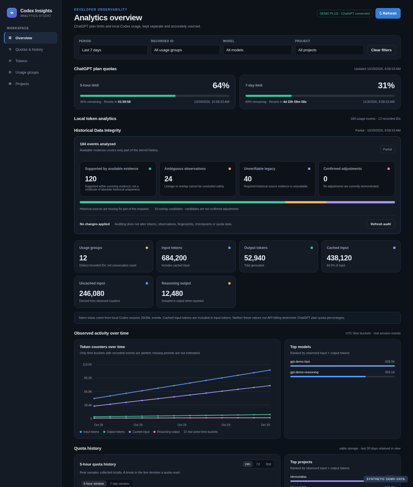

# Codex Insights

Token observations from earlier versions may include inherited cumulative counters. New imports retain [counter provenance and an explicit reconciliation status](docs/TOKEN_ACCOUNTING_CORRECTION.md); existing history is preserved until a reviewed repair is available.

**Professional analytics and usage monitoring for OpenAI Codex in Visual Studio Code.** Codex Insights is an independent, local-first VS Code extension. It is **not an official OpenAI extension** and sends no custom telemetry.

Version **0.4.2** adds an automatic native Status Bar hover with visual quota bars. The full React analytics dashboard remains available; the editor-based mini panel is an optional command.

## Features

- Read real ChatGPT plan quota percentages and reset timestamps through the local Codex App Server, including the 5-hour and 7-day windows when available.
- Show live countdowns without polling every second, and record real quota samples for historical charts.
- Index local Codex JSONL sessions and analyze input, output, cached input, and reasoning output tokens.
- Explore timestamped token charts, sessions, models, and projects with combined period, custom date range, session, model, and project filters.
- Persist quota samples and normalized session entities in SQLite, with local JSON fallback for runtimes without `node:sqlite`.
- Deduplicate repeated observations, retain indexed history across restarts, and keep credentials under Codex CLI's control.
- Hover over the VS Code Status Bar indicator to see official quota percentages, visual progress bars, reset times, and local activity without clicking. Click to open the full dashboard.



*Actual VS Code 1.90 native hover with synthetic data.* [Light theme](docs/assets/status-hover-light.png) · [High contrast](docs/assets/status-hover-high-contrast.png)



*Demo dashboard with synthetic data.*

The optional [React mini panel preview](docs/assets/mini-dark-normal.png) is an editor Webview and does not open on hover or on Status Bar click by default.

The Status Bar hover uses VS Code's native Markdown tooltip. Its quota percentages mean **used**, and its token totals cover **all recorded local history**. A sample with synthetic data:

```text
Codex Insights · Connected · ChatGPT Plus
5-hour limit: 68% used · 32% available · Resets in 1h 24m
7-day limit: 16% used · 84% available · Resets in 6d 19h
Local activity · all recorded history: Input 1.2M · Output 24.5K
```

The hover distinguishes loading, sign-in, offline, stale, warning (80% used), critical (95% used), and exhausted (100% used) states. Old samples are labeled **last known**. The hover links to **Dashboard**, **Refresh**, and **Copy**. Click the indicator to open the dashboard; set `codexInsights.statusBar.clickAction` to `miniPanel` only if you prefer the optional editor panel. Copy Summary writes plain text with its generation time and no credentials or conversation content. See [Status Summary design and limitations](docs/STATUS_SUMMARY_0.4.2.md).

## Requirements and installation

- Visual Studio Code **1.90+**.
- Codex CLI with `codex app-server --stdio` (real-account baseline verified with CLI **0.162.1**; account and quota reads also verified locally with **0.163.0**).
- A ChatGPT login in Codex CLI to display ChatGPT plan quotas. API-key accounts do not expose those plan quotas.

Install the latest reviewed VSIX using **Extensions → … → Install from VSIX…**, reload VS Code, then run **Codex Insights: Open Dashboard** from the Command Palette. The extension identifier remains `codex-insights-local.codex-insights`, so updates preserve the extension storage location.

To sign in, run `codex login` and complete the browser flow, or use **Codex Insights: Sign in with ChatGPT**. Check CLI login state with `codex login status`. Codex Insights delegates authentication to Codex App Server; it does not read `auth.json` or store access tokens.

## Development

Use **Node.js 22** and npm. From this repository root:

```bash
npm ci
npm run typecheck
npm test
npm run build
npm run test:e2e
npm run package
npm run benchmark
```

`build` writes the Extension Host bundle to `dist/extension.js` and the React bundles to `media/dashboard.js` and `media/mini-panel.js`. `package` creates `codex-insights-0.4.2.vsix`. These generated files are excluded from Git. Open the folder in VS Code and press **F5** to start an Extension Development Host. `npm run watch` rebuilds all three bundles. `npm run screenshot:mini` renders synthetic mini panel screenshots from the real bundle using local Chromium. The benchmark is synthetic, creates only temporary data, and is documented in [the v0.4.0 comparison](docs/PERFORMANCE_COMPARISON_0.4.0.md). The package excludes the E2E test bundle.

Run the isolated VS Code Electron suite with `npm run test:e2e`; Linux CI uses `xvfb-run -a npm run test:e2e`. The suite downloads VS Code 1.90.0 on first run, uses synthetic data, and does not use Codex credentials or App Server. See [the E2E guide](docs/E2E_TESTING_0.4.1.md).

## Architecture and data sources

| Directory | Responsibility |
| --- | --- |
| `src/extension` | Activation, commands, Status Bar, timers, Webview lifecycle, and cleanup. |
| `src/providers` | Private `codex app-server --stdio` subprocess, JSON-RPC, login handoff, and quota normalization. |
| `src/collectors` | Local JSONL discovery and persistent session index. |
| `src/storage` | SQLite migrations and tables for quota samples, projects, models, sessions, token events, and import state. |
| `src/analytics` | Aggregations, historical series, and combined filters. |
| `src/reconciliation` | Offline, read-only historical audit and evidence-linked repair proposals. |
| `src/webview` | React dashboard, countdowns, styles, and Content Security Policy. |
| `src/protocol/generated` | TypeScript contracts generated from Codex App Server. |

Quota percentages are **official account-level values** reported by App Server. Token counters are **locally observed** in Codex session files; they are not API billing and cannot be used to infer ChatGPT quotas. `cached_input_tokens` is already part of `input_tokens`. Reasoning output is displayed separately and is not added again to output totals. Token filters never change global quota percentages.

All history is stored under VS Code's extension `globalStorageUri`, outside the source tree. SQLite records a SHA-256 account identifier rather than the raw account ID. JSON fallbacks are written atomically. Session records store metadata and token counts, not conversation content. The Webview receives no credentials, cannot access local files directly, and has a restrictive CSP. There is no project-owned server, external telemetry, or Marketplace publishing workflow.

## Configuration

| Setting | Purpose |
| --- | --- |
| `codexInsights.sessionsPath` | Override `CODEX_HOME/sessions` or `~/.codex/sessions`. |
| `codexInsights.refreshSeconds` | Local session scan interval, minimum 15 seconds. |
| `codexInsights.codexExecutable` | Codex CLI executable; default `codex`. |
| `codexInsights.quotaRefreshSeconds` | Quota polling interval, minimum 60 seconds. |
| `codexInsights.statusBar.compact` | Shorter quota labels in the Status Bar; default `false`. |
| `codexInsights.statusBar.showWeeklyQuota` | Include the 7-day quota in the Status Bar and hover; default `true`. |
| `codexInsights.statusBar.clickAction` | `dashboard` (default) or optional `miniPanel` when clicking the Status Bar item. |

## Testing and troubleshooting

`npm test` runs simulated JSON-RPC recovery, timeout, malformed protocol, SQLite migration and corruption, session-index, deduplication, filter, countdown, message-boundary, lifecycle, Status Bar formatting, SVG progress, and React rendering tests. These tests do not generate model usage. The isolated Electron suite verifies Status Bar updates, real Webview mounting, commands, and mini panel lifecycle with synthetic data. The native hover was visually inspected in VS Code 1.90 using synthetic fixtures in dark, light, and high contrast themes; real-account comparison remains a manual release check.

The dashboard's **Usage groups** count is the number of distinct IDs attached to local token events, not a verified count of independent conversations. A `session_meta` record without usable token observations does not create a usage group. The table shows up to 250 groups, ordered by latest activity so a new low-token group is visible. Older indexes can contain response-item IDs such as `ctco_` because of a previous attribution error. The collector now keeps new usage with the verified `session_meta` identity, while preserving old token amounts for a separately reviewed repair. See the [session classification audit](docs/SESSION_CLASSIFICATION_AUDIT.md). Run `npm run audit:sessions` for anonymous, read-only local counts; it prints no paths, IDs, prompts, or responses.

**Historical integrity review:** A separate offline auditor can classify stored token events and prepare a private, evidence-linked proposal from an isolated SQLite or JSON snapshot. It never applies changes; `--repair` and `--apply` are disabled. Use `node scripts/audit-history.mjs --help` and read [Historical reconciliation and safe dry-run](docs/HISTORICAL_RECONCILIATION_0.4.3.md) before using it. The dashboard marks unreconciled history and says **No changes applied**; its displayed totals are still the recorded values. Keep detailed plans outside the repository and do not share them publicly.

If quotas are unavailable, check `codex --version`, `codex app-server --help`, `codex login status`, and the executable setting, then run **Codex Insights: Refresh**. If sessions are missing, check the session path and selected period. Quota history begins when the extension starts sampling; it cannot be reconstructed from token events.

## Known limitations and roadmap

- A continuation reads only new bytes. Ambiguous replacement or truncation reconciles the affected file safely.
- The dashboard limits each view to 250 recently active usage-group rows and 500 time points for responsiveness; it does not yet offer a separate inventory of metadata-only conversations.
- Alerts, predictions, exports, and DOM-level visual Webview automation remain planned.

New observability providers should emit typed, timestamped observations with explicit provenance. Keep official quotas separate from observed and estimated metrics, add a schema migration for persisted fields, and expose only calculated views to the Webview.

## Contributing and security

See [CONTRIBUTING.md](CONTRIBUTING.md) for development and pull requests. Report vulnerabilities privately as described in [SECURITY.md](SECURITY.md); do not publish credentials or sensitive records in Issues. The detailed 0.3.1 review is in [docs/SECURITY_AUDIT_0.3.1.md](docs/SECURITY_AUDIT_0.3.1.md).

## License

[MIT](LICENSE). Third-party notices for the bundled React runtime are in `media/licenses/`.
